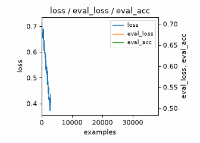

# liveplot

<!-- --8<-- [start:intro] -->
Live training curves in Jupyter, Colab and the VS Code / Cursor interactive window, with a tqdm bar underneath, at (almost) no cost to the training loop.

[](https://arena-education.github.io/liveplot/) [](https://colab.research.google.com/github/ARENA-education/liveplot/blob/demo/examples/demo.ipynb) [](https://github.com/ARENA-education/liveplot/actions/workflows/tests.yml)
<!-- --8<-- [end:intro] -->



<!-- --8<-- [start:overview] -->
## Install

```
pip install "liveplot[notebook] @ git+https://github.com/ARENA-education/liveplot.git"
```

`matplotlib`, `numpy` and `pillow` are the requirements. The `notebook` extra adds `ipython` for the live display and `tqdm` for the progress bar. A notebook already has both, so plain `pip install git+https://github.com/ARENA-education/liveplot.git` is enough there.

## Quickstart

```python
from liveplot import LivePlot

plot = LivePlot(loader, "loss | acc", "lr")   # wrap the loop, like tqdm
plot["acc"].set_ylim(0, 1)                    # configure, like matplotlib
for batch in plot:
    loss, acc = train_step(batch)
    plot.log(loss=loss, acc=acc, lr=lr)       # log, like wandb
```

- **Wrap the loop.** `LivePlot(loader)` yields the loader's items. Each item moves the x-axis one step and updates the progress bar. `plot.log` on its own does not move x.
- **Log by name.** `plot.log(loss=loss)` adds a point to the curve `loss` at the current x. A metric exists from the first time you log it.
- **Lay out with strings.** Each string is one panel. Names separated by spaces share a y-axis. Names after `|` go on a right-hand y-axis. Here `loss` and `acc` share a panel with two y-axes, and `lr` has its own panel. With no strings, every metric shares one panel.
- **Configure with matplotlib's names.** `plot["acc"]` is the y-axis that holds `acc`.

For nested epoch and batch loops, create the plot once and wrap the inner loop with `plot(...)`. The x-axis continues across epochs:

```python
plot = LivePlot("loss", "acc")
for epoch in range(epochs):
    for batch in plot(loader, desc=f"epoch {epoch}"):
        plot.log(loss=train_step(batch))      # one point per batch
    plot.log(acc=evaluate())                  # one point per epoch
plot.finish()
```

The plot is drawn by a separate process and shown as a plain image, so it behaves the same in every notebook front end, and interrupting a cell is safe. Everything you log is also kept in `plot.data`.
<!-- --8<-- [end:overview] -->

## Documentation

The documentation is at **<https://arena-education.github.io/liveplot/>**:

- [Common questions](https://arena-education.github.io/liveplot/questions/): is `total` needed, why wrap the dataloader, two metrics on one axis, a right-hand axis, several panels.
- [Guide](https://arena-education.github.io/liveplot/guide/): the x-axis, panels, logging at different rates, customising axes, reference lines, images, smoothing, saving and recording.
- [API reference](https://arena-education.github.io/liveplot/api/): every class and method, generated from the docstrings.

The pages are built from [`docs/`](docs/) and the docstrings in [`liveplot/liveplot.py`](liveplot/liveplot.py). To build them locally:

```
pip install -e ".[docs]"
mkdocs serve
```

## Examples

[`examples/demo.py`](https://github.com/ARENA-education/liveplot/blob/main/examples/demo.py) is a cell-by-cell tour of the features. Run it in the VS Code / Cursor interactive window, or [open it in Colab](https://colab.research.google.com/github/ARENA-education/liveplot/blob/demo/examples/demo.ipynb): CI converts it to a notebook on the `demo` branch on every push to `main`. The GIF above is cell 2 of that file, recorded by the library itself in [`examples/make_gif.py`](https://github.com/ARENA-education/liveplot/blob/main/examples/make_gif.py). [`examples/dcgan_synthetic.py`](https://github.com/ARENA-education/liveplot/blob/main/examples/dcgan_synthetic.py) shows loss curves beside generated images.

## Credits

The per-panel label/limit options and the grid-shape rule are adapted from Tyler Lum's [live_plotter](https://github.com/tylerlum/live_plotter) (MIT); see `THIRD_PARTY_LICENSES.md`.
