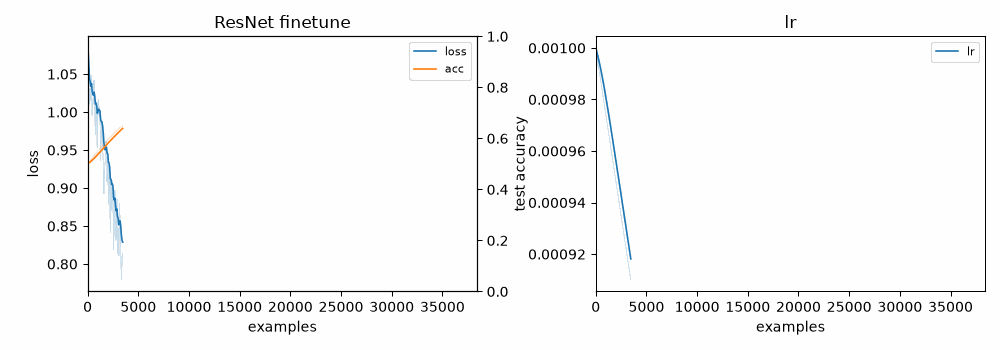

# Customising axes

Setters use matplotlib's names. Call them before or during the loop; the next frame picks them up.



## Which object to call

| Object | Get it with | Changes |
|---|---|---|
| Axis | `plot["acc"]` | The y-axis holding that metric, left or right |
| Panel | `plot.panels[0]`, `plot["acc"].panel` | One panel, and its left axis |
| Plot | `plot` | Every panel, including later ones |

```python
plot = LivePlot(loader, "loss | acc", "lr")

plot["acc"].set_ylim(0, 1)                   # right-hand axis of panel 0
plot["acc"].set_ylabel("test accuracy")
plot["lr"].set_yscale("log")

plot.panels[0].set_title("training")         # one panel
plot.panels[0].set_xlim(0, 10_000)

plot.set_xlabel("batches")                   # every panel
```

`plot[metric]` finds the axis on either side. `panel.left` / `panel.right` name the two axes directly.

## The setters

Axis ([reference](../api.md#liveplot.liveplot._Axis)):

| Setter | Effect |
|---|---|
| `set_ylabel(text)` | y label |
| `set_ylim(low, high)` | Fix the y range; also takes one `(low, high)`. Both required. |
| `set_yscale("log")` | `"linear"` or `"log"` |
| `set_marker("o")` | A dot on every point, e.g. a once-per-epoch eval. `None` turns it off. |
| `axhline(y, label)` | Horizontal [reference line](reference-lines.md) |

Panel ([reference][liveplot.liveplot.Panel]):

| Setter | Effect |
|---|---|
| `set_title(text)` | Title |
| `set_xlabel(text)` | x label |
| `set_xlim(low, high)` | Fix the x range |
| `set_smooth(weight)` | [Smoothing](smoothing.md) |
| `legend(**kwargs)` | Move/restyle the legend; kwargs go to `Axes.legend` |
| `axvline(x, label)` | Vertical [reference line](reference-lines.md) |

Panel setters also work on an axis (acting on its panel): `plot["acc"].set_title("evaluation")`. Axis y setters also work on a panel (acting on its left axis).

On the plot, `set_title`, `set_xlabel`, `set_xlim`, `set_ylabel`, `set_ylim`, `set_yscale` and `set_smooth` apply to every panel; the y setters reach left axes only.

## Several at once

`set(**kwargs)`, like `Axes.set`: `name=value` calls `set_name(value)`.

```python
plot["acc"].set(ylabel="test accuracy", ylim=(0, 1))
plot.panels[0].set(title="training", xlabel="examples")
plot.set(xlabel="examples", smooth=0.9)       # every panel
```

## Moving the legend

```python
plot.panels[0].legend(loc="upper left")
plot.panels[0].legend(loc="upper center", bbox_to_anchor=(0.5, -0.15), ncols=3)   # below the panel
```

## Not supported

One-sided limits, and scales other than `"linear"` / `"log"`. For those, take [`plot.figure()`][liveplot.LivePlot.figure] and change it in matplotlib.
