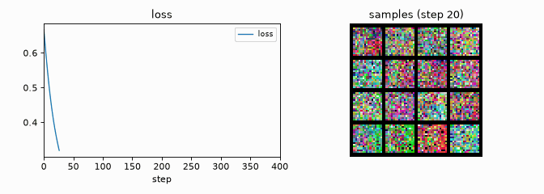

# Images with `subplots` and `imshow`

A panel can hold a picture instead of curves. That lets one figure show loss curves that update every step next to generated samples that update now and then.



## `LivePlot.subplots`

[`LivePlot.subplots`][liveplot.LivePlot.subplots] follows `plt.subplots`. It returns the plot and a fixed grid of empty panels. You then say what each panel holds.

```python
plot, (ax_loss, ax_samples) = LivePlot.subplots(1, 2, figsize=(11, 4))
ax_loss.plot("lossD", "lossG")            # these metrics go on this panel's left axis
ax_loss.twinx().plot("D_real")            # this one goes on its right-hand axis
ax_samples.set_title("generator samples")

for epoch in range(epochs):
    for imgs, _ in plot(loader, desc=f"epoch {epoch}"):
        lossD, lossG, d_real = train_step(imgs)
        plot.log(lossD=lossD, lossG=lossG, D_real=d_real)                     # every step
        if plot.n % 250 == 0:
            ax_samples.imshow(netG(fixed_noise), rows=2, vmin=-1, vmax=1)     # replaces the last picture
plot.finish()
```

- `ax.plot("lossD", "lossG")` names metrics. It takes no data. The values come from `plot.log`.
- `ax.twinx()` is the panel's right-hand y-axis, as in matplotlib.
- `figsize` is the size of the whole figure in inches. `width_ratios` and `height_ratios` are matplotlib's: `width_ratios=(1, 1.25)` gives the second column more room.
- Other keyword arguments go to `LivePlot`, for example `total` or `smooth`. To wrap a single loop, pass `iterable=loader`.

The grid never grows. A metric that you log without placing it joins the first panel that is still empty, or the first curve panel if none is empty.

### What `subplots` returns

The second return value follows matplotlib's squeeze rules:

| Grid | `axes` is |
|---|---|
| 1 x 1 | one panel |
| one row or one column | a flat list of panels |
| anything larger | a 2-d grid: `axes[0][1]` and `axes[0, 1]` both work, and `axes.flat` lists every panel |

`squeeze=False` always returns the 2-d grid.

## `plot.imshow` for a single picture

When you only need one picture, [`plot.imshow`][liveplot.LivePlot.imshow] adds an image panel on first use. Every later call replaces the picture.

```python
plot = LivePlot(range(steps))
for step in plot:
    plot.log(loss=train_step())
    if step % 100 == 0:
        plot.imshow(model(holdout))
```

On a plot made by `subplots`, call `imshow` on a panel instead.

## What `imshow` accepts

Torch tensors, numpy arrays and other array-likes. Tensors are detached and moved to the CPU for you. liveplot does not import torch.

| Shape | Read as |
|---|---|
| `(H, W)`, `(1, H, W)` | one grayscale image |
| `(H, W, 3)`, `(H, W, 4)` | one colour image, channels last |
| `(B, H, W)` | `B` grayscale images |
| `(B, 1|3|4, H, W)` | `B` images, channels first (torch's layout) |
| `(B, H, W, 1|3|4)` | `B` images, channels last |

`(3, H, W)` and `(4, H, W)` could be one colour image or several grayscale ones, so they raise an error. Pass `channels="first"` for one colour image or `channels="none"` for a batch of grayscale images.

A 3-d array whose last dimension is 3 or 4 is read as one colour image. So a batch of grayscale images that are 3 or 4 pixels wide needs `channels="none"`.

## Grids

A batch is tiled into a grid.

- `rows=2` or `cols=5` fixes one dimension. The other is inferred.
- `griddim=(rows, cols)` fixes both. Missing cells are left blank and extra images are dropped.
- With none of these the grid is near-square and at most `max_cols` (8) wide.
- Only the first `max_images` (64) images are shown, with a warning. Pass `max_images=None` to show all of them.
- Images sit edge to edge. `padding=2` puts 2 pixels of `pad_value` around each one.

## Scaling

By default, values are scaled so that the minimum of the batch is black and the maximum is white.

- `vmin` and `vmax` fix the range. This is worth doing for a live view. Otherwise the brightness of the whole picture changes from frame to frame as the batch's range changes.
- `scale_each=True` scales each image to its own range.
- `uint8` input is shown as it is, unless you give `vmin` or `vmax`.

`vmin` and `vmax` apply to colour images too. This differs from matplotlib's own `imshow`, which ignores them for colour data and clips floats to `[0, 1]`. A generator that ends in `tanh` outputs values in `[-1, 1]`, so use `vmin=-1, vmax=1`.

## The step in the title

The title of an image panel shows the step at which the picture was drawn, for example "generator samples (step 250)". The picture only changes when you call `imshow`, so this tells you how old it is.

[`examples/dcgan_synthetic.py`](https://github.com/ARENA-education/liveplot/blob/main/examples/dcgan_synthetic.py) is a complete example on a fake DCGAN run.
