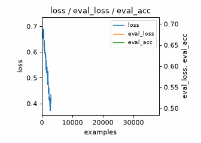

# Logging at different rates

## What `log` accepts

[`plot.log`][liveplot.LivePlot.log] takes metric values by name:

```python
plot.log(loss=0.3, acc=0.9)          # at the current x
plot.log(step, loss=0.3)             # at an explicit x
plot.log(step, {"loss": 0.3})        # a dict, useful when names are not valid Python identifiers
plot.log({"loss": 0.3})              # a dict at the current x
```

A value is anything `float()` accepts. That includes a one-element tensor. For a tensor that requires grad, PyTorch warns when it is converted, so pass `loss.item()` or `loss.detach()`.

## Different rates need nothing special

Every metric keeps its own list of `(x, value)` points. Each `log` call adds a point to the metrics it names, at the current x. So a metric logged every step gets a point per step, and a metric logged every 50 steps gets a point every 50 steps. Both are drawn against the same x-axis.

```python
plot = LivePlot(range(num_steps), "loss | eval_loss eval_acc")
for step in plot:
    plot.log(loss=train_step())                              # every step
    if step % 50 == 0:
        eval_loss, eval_acc = evaluate()
        plot.log(eval_loss=eval_loss, eval_acc=eval_acc)     # every 50 steps
```



## Once per epoch

Log after the inner loop. The point lands at the x the count has reached, which is the number of batches so far:

```python
plot = LivePlot("loss", "acc")
for epoch in range(epochs):
    for batch in plot(loader, desc=f"epoch {epoch}"):
        plot.log(loss=train_step(batch))
    plot.log(acc=evaluate())      # at x = (epoch + 1) * len(loader)
plot.finish()
```

## Reading the values back

- `plot.data` is the full history: `{metric: (xs, values)}`, two lists per metric.
- `plot.latest` is the most recent value of each metric.

Both are filled in whether or not anything is drawn, so they also work in a script.

```python
xs, losses = plot.data["loss"]
best = min(losses)
```

## Collecting without drawing

`LivePlot(..., show=False)` draws nothing. The metrics are still collected and the progress bar still shows the latest values. `progress=False` turns the bar off. The two options are independent.
