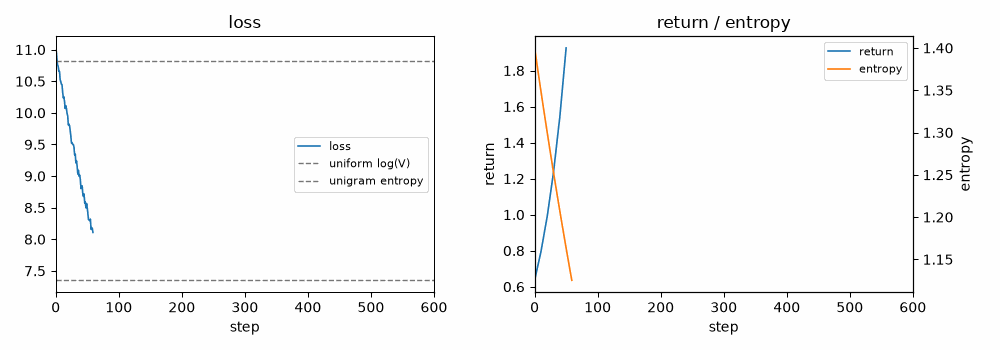

# Reference lines

matplotlib's names: `axhline` for a level to reach, `axvline` for a moment in the run.



## Horizontal

Call `axhline` on the metric's axis:

```python
plot["loss"].axhline(math.log(d_vocab), "uniform")       # loss of a uniform guess
plot["return"].axhline(500, "solved", color="green")
```

- Dashed grey by default; extra kwargs (`color`, `linestyle`, `linewidth`, `alpha`) go to matplotlib.
- The label goes in the legend. Without one, the legend shows the number.
- Drawn on the scale of the axis you called it on, so `plot["acc"].axhline(0.9)` uses the right axis if `acc` is there.

`plot.axhline(y, label)` draws on the left axis of every panel that exists now (not later ones). `plot.axhline(y, label, metric="loss")` equals `plot["loss"].axhline(y, label)`.

## Vertical

```python
plot.axvline(label="lr drop")                   # every panel, at the current step
plot.panels[1].axvline(2000, "checkpoint")      # one panel, at x = 2000
```

- No `x`: drawn at [`plot.step`][liveplot.LivePlot.step] at call time, so you can mark an event where it happens.
- Dotted grey by default; extra kwargs go to matplotlib.
- The label is written along the line, not in the legend.
- `plot.axvline` covers every curve panel, including later ones. Image panels are skipped.

```python
for step in plot:
    if step == warmup_steps:
        plot.axvline(label="warmup ends")
    plot.log(loss=train_step())
```
