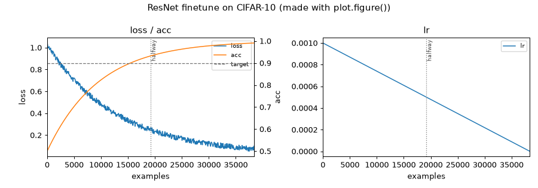

# Saving and recording

## A matplotlib figure of the current state

[`plot.figure()`][liveplot.LivePlot.figure] returns a matplotlib `Figure` of the plot as it stands: the same panels, curves, reference lines and images.

```python
fig = plot.figure()
fig.suptitle("run 12")
fig.savefig("run12.png", dpi=150)
```



The figure is built from `plot.data` when you call it. It is separate from the live display, so changing it does not change the live plot. It works during the run and after it, and also in a script or with `show=False`, where nothing is drawn live.

## Recording a GIF

`record="run.gif"` keeps every frame that is drawn and writes an animated GIF when the plot finishes:

```python
plot = LivePlot(range(steps), "loss | acc", record="run.gif")
for step in plot:
    plot.log(loss=train_step())
```

The GIF replays at the pace of the run. Recording also works in a plain script, where nothing is displayed.

`record=True` keeps the frames without writing a file. Write one later with [`plot.save_gif`][liveplot.LivePlot.save_gif]:

```python
plot = LivePlot(range(steps), record=True)
...
plot.save_gif("run.gif", speedup=2.0)     # twice as fast as the run
```

The frames are in `plot.frames` as `(seconds since the plot was created, PNG bytes)` pairs. `plot.last_png` is the most recent frame.

One frame is recorded per redraw, so `refresh_seconds` sets how many frames a recording has.
