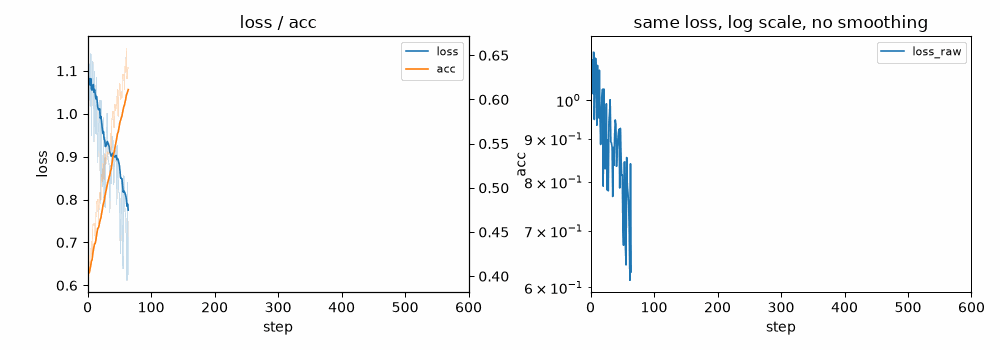

# Smoothing and log axes

## Smoothing

`set_smooth` draws a smoothed curve over the faded raw values.



```python
plot.set_smooth(0.9)                  # every panel
plot.panels[0].set_smooth(0.9)        # one panel
plot["loss"].set_smooth(0.9)          # loss's panel
plot = LivePlot(loader, smooth=0.9)   # default for every panel
```

- Weight in `[0, 1)`; larger is smoother, 0 is off.
- Per panel: every curve on it, both axes.
- Drawing only: `plot.data` stays raw.

It's wandb's default, the [time-weighted EMA](https://docs.wandb.ai/models/app/features/panels/line-plot/smoothing), with the same weight as wandb's slider. As in wandb, smoothing depends on how points spread over the x range, not their count. The x range is the data so far, so short runs are barely smoothed and the curve can shift as the run grows. With `fixed_x=True` and a `total`, the range is the whole run from the start.

## Log axes

```python
plot["loss"].set_yscale("log")        # loss's axis
plot.set_yscale("log")                # left axis of every panel
```

`"linear"` or `"log"`; y only.
