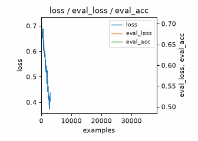

# liveplot

--8<-- "README.md:intro"

--8<-- "README.md:overview"

## Where to go next

- [Common questions](questions.md) has short answers to what people ask first.
- The [guide](guide/index.md) explains each feature with examples.
- The [API reference](api.md) lists every class and method.
- [`examples/demo.py`](https://github.com/ARENA-education/liveplot/blob/main/examples/demo.py) is a cell-by-cell tour. You can [open it in Colab](https://colab.research.google.com/github/ARENA-education/liveplot/blob/demo/examples/demo.ipynb).
